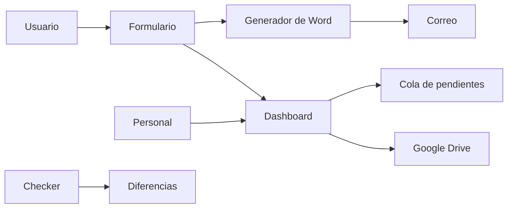
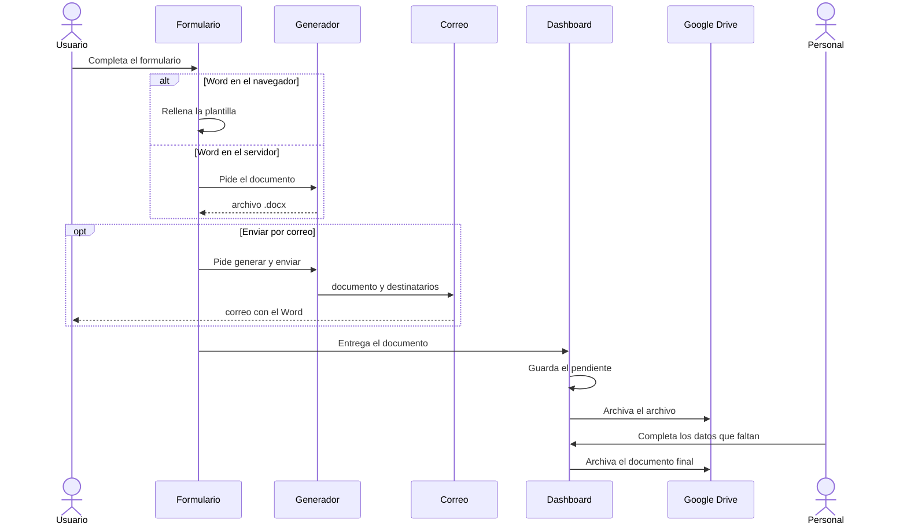
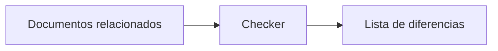
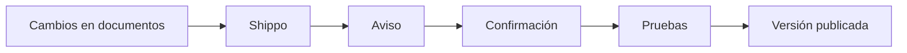

# Masterview — operación documental

Mapa de un sistema de documentos para **Masterview S.A.**: un formulario arma un Word, puede enviarlo por correo, lo entrega a un dashboard y un checker compara los documentos entre sí.

Este repositorio no duplica el código. Cada pieza vive en su propio servicio. Aquí está el recorrido y el enlace a cada uno.

## Recorrido

1. La persona completa el formulario y obtiene el Word, en el navegador o pidiéndoselo al generador.
2. Si el envío es por correo, el generador llama al servicio de correo y adjunta el documento.
3. El formulario entrega el mismo documento al dashboard.
4. El dashboard guarda el pendiente y archiva el archivo en Google Drive.
5. El personal completa los datos que faltan. El servicio genera el documento final y lo archiva.
6. El checker queda fuera de esa cadena. Compara documentos relacionados y marca diferencias de transcripción.

## Secuencia

## Checker

El checker no participa en el envío. Lee Word, PDF y Excel, normaliza texto y números, y devuelve una lista de diferencias.

## Repositorios

| Repositorio | Qué hace | Acceso |
|---|---|---|
| [masterview-formulario-proforma](https://github.com/ndresdavila/masterview-formulario-proforma) | Formulario en React. Arma el Word, pide el correo y entrega el documento al dashboard. | Público |
| [masterview-generador-documento](https://github.com/ndresdavila/masterview-generador-documento) | API en Python. Recibe JSON y devuelve el `.docx`. Si hace falta, llama al correo. | Público |
| [masterview-enviador-correo](https://github.com/ndresdavila/masterview-enviador-correo) | API en Python. Adjunta el documento y lo envía por correo. | Público |
| hbl-dashboard | API en Node y dashboard en React. Cola de pendientes, Google Drive y documento final. | Privado |
| [masterview-document-checker](https://github.com/ndresdavila/masterview-document-checker) | Compara documentos y marca diferencias. | Público |

El dashboard queda privado. Los otros cuatro repositorios se pueden abrir desde aquí.

La lectura de los campos está hecha con plantillas y parsers. Esa es la capa donde se conecta un modelo como Claude o Gemini cuando el documento no cabe en una plantilla fija.

## Cómo lo opero

Shippo es un agente de Cursor, con Grok, en la misma cuenta con la que mantengo estos repos. Revisa si hubo cambios en los documentos. Si hace falta tocar código, lo propone primero. Después de la confirmación, corre las pruebas y publica la versión nueva.

Shippo no es un servicio de este sistema. El historial de esas corridas está en Cursor.
